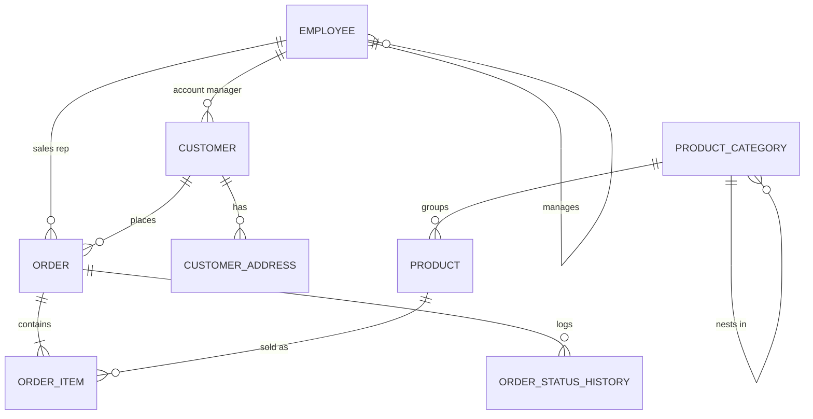

# Employee Database

A PostgreSQL schema for **Employee : Customer : Order : Product**, designed from the start
to sit underneath an Alexa-style voice assistant.

Verified on PostgreSQL 14 (local) and PostgreSQL 14.24 (Azure VM).

## Quick start

```bash
./load.sh                  # build local database "employee_db" (drops and recreates)
./load.sh scratch_db       # build a differently-named local database
./deploy.sh                # push SQL to the VM and rebuild the database there
./deploy.sh --push-only    # copy files up, leave the database alone
./deploy.sh --psql         # psql shell on the server database
```

`sql/` files are numbered and applied in order; each is independently re-readable.

| file | contents |
|---|---|
| `01_extensions.sql` | citext, pg_trgm, fuzzystrmatch, unaccent; ENUM vocabularies |
| `02_core_tables.sql` | employee, customer, address, category, product, order, order_item, status history |
| `03_indexes.sql` | ordinary access paths + trigram/phonetic indexes for voice lookup |
| `04_views.sql` | the six flat "answer" views |
| `05_ai_layer.sql` | `ai` schema: entity resolution, conversation log, self-describing prompt |
| `06_comments.sql` | COMMENT ON — doubles as the assistant's schema documentation |
| `07_roles.sql` | `ai_assistant` (read + own-log only) and `app_service` |
| `08_seed.sql` | 6 employees, 8 customers, 14 products, 17 orders, aliases, intents |

## Viewer

A plain text web page for looking at the data — no charts, no framework, no build step.

```bash
web/run.sh                 # creates web/.venv on first run, serves http://127.0.0.1:5001
DATABASE_URL="dbname=employee_db" web/run.sh
```

Buttons for each dataset (orders, customers, products, employees, restock, daily sales,
voice aliases, intents, conversation log), a box to look up one order's line items, and a
**voice lookup** box where you type a misheard phrase (`mowse`, `aysha puttell`, `jon smyth`)
and see the ranked candidates the assistant would get back. Tick "show SQL" to see the query
behind whatever is on screen.

The browser never sends SQL: it picks a key from a server-side whitelist, and free text only
ever reaches `ai.resolve_*()` as a bound parameter.

## Shape



## What the voice requirement changed

A schema that is merely correct is not enough for speech input. Five decisions exist only
because an assistant will query this:

**1. Names are spoken, so lookups must be fuzzy.** Speech recognition delivers "jon smyth",
"aysha puttell", "wireless mowse". Every user-facing name carries both a trigram index and a
`dmetaphone` (sounds-like) index, and `ai.resolve_customer/product/employee/order()` try four
strategies in order — curated alias, exact, trigram similarity, phonetic equality — returning
*ranked candidates with a score and a reason* rather than one guess. Close top-two scores are
the assistant's cue to ask "did you mean…?" instead of answering confidently and wrongly.

```sql
SELECT * FROM ai.resolve_customer('jon smyth');    -- 1.00  alias       -> John Smith
SELECT * FROM ai.resolve_customer('maria gonzales');-- 0.76  fuzzy_name  -> Maria Gonzalez
SELECT * FROM ai.resolve_customer('aysha puttell'); -- 0.70  sounds_like -> Aisha Patel
SELECT * FROM ai.resolve_product('microphone for meetings'); -- 0.60 full_text -> USB Microphone
SELECT * FROM ai.resolve_order('a1003');            -- punctuation-insensitive
```

**2. `ai.entity_alias` is the memory of what people actually say.** Nicknames ("Bobby"),
abbreviations ("MBP"), and recurring ASR errors get rows, with `is_learned` separating
curated aliases from ones harvested out of confirmed corrections. Fixing a misheard name is a
one-row INSERT, not a model change.

**3. Views are the answer surface.** A spoken question should become a one-table `SELECT`
with a filter and an aggregate — not a five-way join the model has to invent. `v_order_summary`,
`v_order_line`, `v_customer_360`, `v_product_performance`, `v_employee_sales` and `v_daily_sales`
are flat, fully labelled, and already exclude cancelled and refunded orders from revenue.

**4. The schema documents itself to the model.** `ai.schema_context` reads table and column
`COMMENT`s straight out of the catalogue, so the system prompt is generated from the live
database instead of a hand-maintained string that drifts. `ai.enum_values` exposes every legal
status so the model maps spoken words onto real values instead of inventing literals. Writing a
comment *is* teaching the assistant:

```sql
SELECT * FROM ai.schema_context WHERE table_name = 'order';
```

**5. Conversation state is stored, not just logged.** `ai.voice_session.context` holds the
last-mentioned entities, which is what lets "and what did *he* order last time?" resolve.
`ai.utterance` keeps one row per turn — transcript, ASR confidence, detected intent, resolved
entities, generated SQL, outcome, latency, and thumbs-up/down. `ai.v_failure_review` ranks what
is going wrong so the fix loop has a queue.

`ai.intent` additionally carries vetted `sql_template`s with named `:slots`. Parameterising a
known-good query is markedly more reliable than free-form NL→SQL, and it keeps values bound
rather than concatenated.

## Assistant request path

```
speech -> transcript
      -> intent match           (ai.intent)
      -> slot fill              ("customer" = "jon smyth")
      -> ai.resolve_*()         -> ranked candidates -> confirm if ambiguous
      -> sql_template + bound params, or generated SQL over the v_* views
      -> execute as role ai_assistant  (5s statement_timeout)
      -> spoken answer + one row in ai.utterance
```

## Security model

`ai_assistant` writes its own SQL, so the database is where destructive statements get stopped —
not the prompt. It holds `SELECT` on business data, `SELECT/INSERT/UPDATE` on its own two log
tables, `EXECUTE` on the resolvers, and nothing else. Verified: `UPDATE product` and
`DELETE FROM "order"` are both refused; logging a turn succeeds. A 5-second `statement_timeout`
keeps a runaway generated query from becoming a stalled voice response.

Create per-environment login users and grant them the role:

```sql
CREATE USER alexa_bot LOGIN PASSWORD '...';  GRANT ai_assistant TO alexa_bot;
```

## Traps worth knowing

- `order` is a reserved word — always `"order"`.
- `order_item.unit_price` is a **price snapshot**. Historical revenue must use it; never join
  back to `product.unit_price`, which moves with the catalogue.
- Order totals are not stored on `"order"`. Use `v_order_summary.grand_total`
  (items + shipping + tax − order discount).
- Line-level discounts are already inside `order_item.line_total`; `"order".discount_total` is
  a separate order-level figure.
- Cancelled and refunded orders are excluded from every `v_*` revenue figure.

## Deployment

Live on the Azure VM at `20.151.118.114`, database `employee_db`, PostgreSQL listening on
**localhost only** — not reachable from the internet. Reach it over SSH, or via a tunnel:

```bash
ssh -i free-server_key.pem -L 5433:localhost:5432 azureuser@20.151.118.114
psql -h localhost -p 5433 -d employee_db
```
